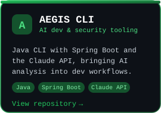
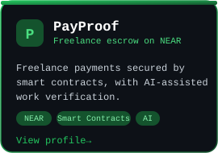
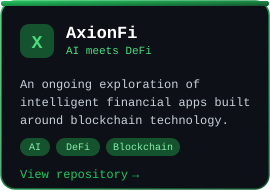

  

  
  
  
  

 

  

 

## ⚡ Stack

  

 

## 🚀 Featured Projects

<table align="center">
  <tr>
    <td></td>
    <td></td>
    <td></td>
  </tr>
</table>

 

## 🟢 Now

  

 

  <i>"Great software is built at the intersection of engineering, creativity, and curiosity."</i>

